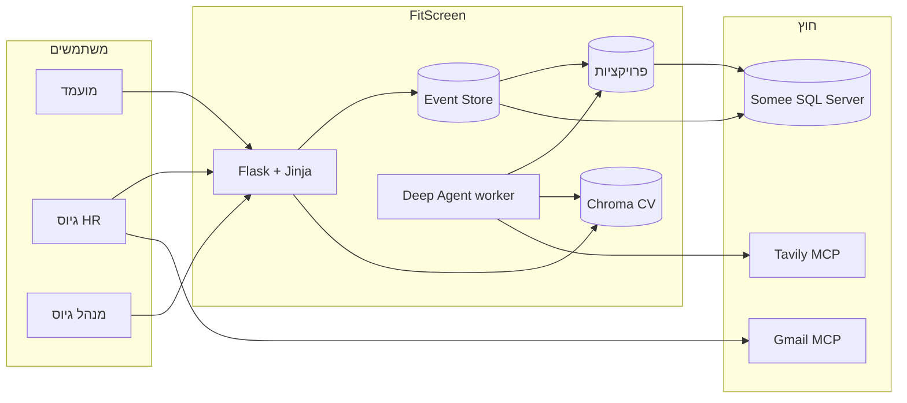

# 00 — מהי המערכת

FitScreen מסננת מועמדים למשרות. המסכים והמסמכים מדברים רק על גיוס: משרה, קורות חיים, ציון והחלטה.

## הבעיה

צוות גיוס מקבל עשרות קורות חיים למשרה. הסינון הידני איטי ולא אחיד. אין תיעוד של למה מועמד התקדם או נדחה, ואין שימוש שיטתי בתוכן ה-CV מול דרישות המשרה.

## הפתרון

FitScreen היא מערכת גיוס:

1. המגייסת כותבת משרה, ומנהל הגיוס פותח אותה לקבלת מועמדויות.
2. במשרה יש כישורים שהם חובה וכישורים שהם יתרון.
3. מועמד מחפש משרה, רואה פרטים, ומגיש קורות חיים.
4. תהליך נפרד מהאתר קורא את קורות החיים, משווה אותם למשרה, בודק אילו דרישות מכוסות, ומחפש ראיות באינטרנט.
5. המגייסת רואה דוח ומחליטה: זימון לראיון, דחייה, או הצעת עבודה. ההחלטה נשמרת, ותהליך הרקע יכול לשלוח למועמד מייל.

## משתמשים

| תפקיד | מטרה |
|---|---|
| מועמד | למצוא משרה פתוחה ולהגיש מועמדות |
| מגייסת | לכתוב משרות, לראות מועמדים ואת ציון הסוכן, ולהחליט |
| מנהל גיוס | לאשר פתיחה וסגירה של משרה, ולראות את לוח הבקרה |

## ערך

- ההחלטה נשענת על קורות החיים, על ההשוואה למשרה, ועל מה שנמצא באינטרנט.
- כל שינוי נשמר כאירוע, ואפשר לראות אחר כך למה מועמד התקדם או נדחה.
- המסכים קוראים מטבלאות מוכנות. הכתיבה נשמרת בנפרד, כאירוע.

## תרשים הקשר

## מסע משתמש (בלי הנחות)

1. המגייסת נרשמת וכותבת משרה כטיוטה, עם כישורי חובה וכישורים רצויים.
2. מנהל הגיוס מאשר את הפתיחה. רק אז מועמד יכול להגיש.
3. מועמד מחפש משרה פתוחה, פותח פרטים, ומעלה קורות חיים (קובץ טקסט, או PDF שיש בו טקסט).
4. תהליך נפרד מהדפדפן קורא את ההגשה, משווה למשרה, בודק דרישות, מחפש באינטרנט, ושומר ציון.
5. המגייסת רואה בלוח הבקרה את המשרות הפתוחות ואת מספר הנרשמים, נכנסת למועמדות, ובוחרת זימון, דחייה או הצעה.

## מחוץ לגבול

- אין תשלום, אין התחברות ארגונית אחת, ואין יומן ראיונות. יש רק סטטוס "זומן לראיון".
- המסכים נבנים בשרת, כתבניות בתוך Flask. אין אתר נפרד ב-React.
- Somee שומר רק את מסד הנתונים. האתר והסוכן רצים אצלנו.
