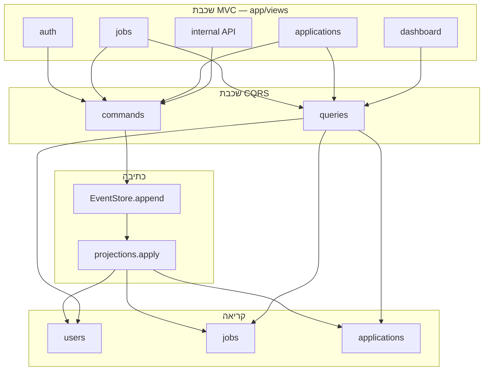
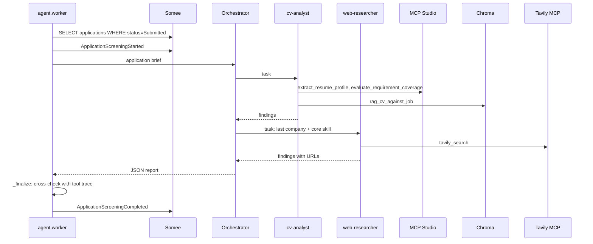
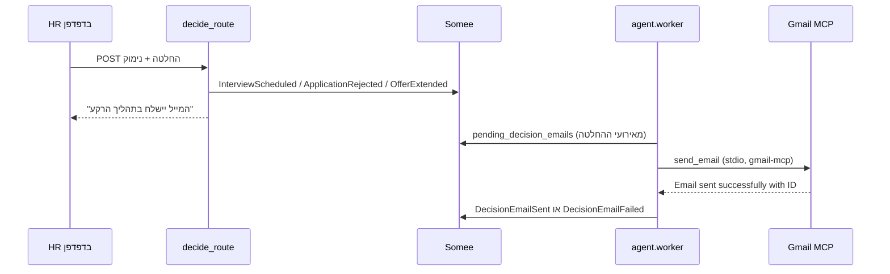

# 02 — איך החלקים מחוברים

## תרשים רכיבים



## סגנון

האתר הוא Flask. המסך, הכתיבה והקריאה מופרדים:

- כתיבה: בודקים את הנתונים, שומרים אירוע, ומעדכנים את הטבלאות שהמסכים קוראים.
- קריאה: רק שולפים מטבלאות המשרות, המועמדויות ולוח הבקרה. לא משנים אותן.

שינוי במסך הולך לכתיבה. מה שמוצג על המסך מגיע מהקריאה.

## מבנה התיקיות

המסך והשרת באותו פרויקט Flask. המסכים הם תבניות Jinja, לא אתר נפרד. הפירוט במסמך ההחלטות, בסעיף "צורת הממשק".

```
app/templates/      המסכים
app/static/         עיצוב
app/views/          בקרי HTTP
app/commands/       כתיבה
app/queries/        קריאה
app/projections.py  עדכון טבלאות הקריאה מהאירועים
agent/              תהליך הסוכן, נפרד מהאתר
mcp_studio/         כלי MCP
docs/               האפיון, 00–08
```

## תהליכים

1. **Web (Flask, gunicorn)**: ממשק משתמש. יש גם API פנימי מוגן במפתח (`/internal/...`, כותרת `X-Agent-Key`) למקרה שסוכן ירוץ על מכונה בלי גישה ישירה למסד.
2. **Worker (Deep Agent)**: process נפרד, קונטיינר `worker`. **קורא רשומות ממסד הנתונים** (`pending_screening`), מריץ `deepagents` עם מתזמר ושני תתי-סוכנים, כלי MCP Studio, Tavily MCP ו-RAG, וכותב אירועים דרך ה-Commands. באותה לולאה הוא גם שולח מיילי החלטה דרך Gmail MCP (`agent/notifier.py`).
3. **Somee SQL Server**: Event Store ופרויקציות בענן.
4. **Chroma**: וקטורי CV על volume משותף ל-web ול-worker (`/app/chroma_data`).
5. **LLM**: Gemini (ענן), ו-Ollama על Windows כגיבוי (`host.docker.internal:11434`).

## זרימת כתיבה

```
UI POST → View → Command handler → EventStore.append
  → Projection.apply → Query tables
```

## זרימת קריאה

```
UI GET → View → Query handler → SELECT מטבלאות פרויקציה
```

## זרימת סוכן (תרשים 2)



תהליך נפרד חובה: `python -m agent.worker`. Flask לבדו לא מעריך מועמדים.

## זרימת מייל החלטה (Gmail MCP)



- ה-view לא שולח מייל. הוא רק מריץ את ה-Command `decide`.
- ה-worker מריץ קודם את שלב המיילים ואחר כך את ההערכות, כי הערכה יכולה לקחת דקות.
- בלי `gcp-oauth.keys.json` או בלי `credentials.json` ב-`secrets/gmail` (מותקן ב-worker כ-`/root/.gmail-mcp`), ה-worker כותב שורת לוג אחת, לא רושם כלום, והמייל נשאר ממתין.
- כישלון נרשם כ-`DecisionEmailFailed`. ניסיון נוסף אחרי `EMAIL_RETRY_SECONDS` (ברירת מחדל 300), עד 3 ניסיונות.
- תבניות המייל קבועות בעברית (`agent/notifier.py`): נושא וגוף לפי סוג ההחלטה, עם שם המשרה, שם המועמד ונימוק ה-HR. נשלח כטקסט וכ-HTML מימין לשמאל.
- התחברות חד-פעמית: `scripts\gmail_auth.ps1` מריץ `gmail-mcp auth` בקונטיינר עם פורט 3000 פתוח, כי Google מחזיר את הדפדפן ל-`http://localhost:3000/oauth2callback`.

## אבטחה

- Cookie session.
- `@login_required` + `@role_required`.
- מפתח פנימי `AGENT_API_KEY` לקריאות ה-worker.

## תלות חיצונית

| שירות | פרוטוקול | תפקיד |
|---|---|---|
| Somee | TDS/SQL | Event Store + read models |
| Tavily | MCP (stdio, `tavily-mcp`) | חיפוש אינטרנט |
| Gmail | MCP (stdio, `gmail-mcp`, OAuth) | מייל החלטה למועמד, נשלח מה-worker |
| Gemini, Ollama כגיבוי | LLM | מודל הסוכן |

Flask **לא** מאוחסן ב-Somee (Somee לא מריץ Python על hosting חינמי).
