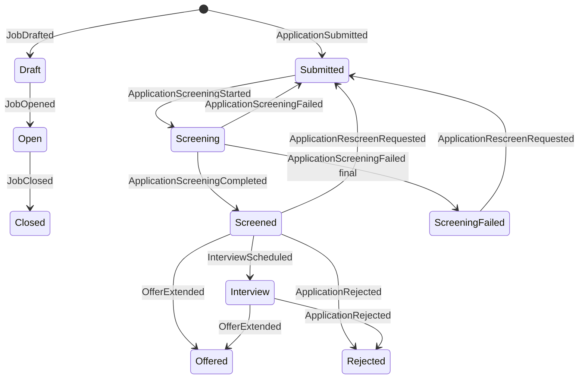

# 03 — מה נשמר

כל שינוי נשמר כשורה בטבלת האירועים. השורה לא נערכת ולא נמחקת. המסכים לא קוראים מהטבלה הזאת. הם קוראים מטבלאות שנבנות ממנה: משתמשים, משרות ומועמדויות.

השם באנגלית בטבלאות למטה הוא השם שנשמר במסד. המשפט לידו אומר מה קורה במערכת.

## טבלת האירועים

טבלה `events`:

| עמודה | משמעות |
|---|---|
| event_id | UUID |
| event_type | שם האירוע |
| aggregate_type | User / Job / Application |
| aggregate_id | מזהה האגרגט |
| version | מספר רץ לאגרגט |
| payload_json | גוף האירוע |
| metadata_json | user_id, source |
| occurred_at | זמן |

אין עדכון ואין מחיקה של שורות אירוע.

## הטבלאות שהמסכים קוראים

- `users` — id, email, password_hash, full_name, role, auth_provider (`password` או `google`; אירוע ישן בלי השדה נחשב `password`)
- `jobs` — id, title, description, must_have_skills, nice_to_have_skills, min_years, location, status, created_by, applicant_count, opened_at
- `applications` — id, job_id, candidate_id, status, cv_path, cv_text, agent_score, agent_report_json, decision_reason
- `dashboard_stats` — חושב ב-query מ-jobs (משרות פתוחות + ספירות)

## קטלוג אירועים

| אירוע | על מה | מה משתנה במסך |
|---|---|---|
| UserRegistered | User | שורת user. ה-payload כולל `role` ו-`auth_provider`. משתמש Google מקבל hash של סיסמה אקראית, כך שטופס הסיסמה לא פותח אותו |
| JobDrafted | Job | משרה Draft |
| JobOpened | Job | status=Open |
| JobClosed | Job | status=Closed |
| JobClosureAnnounced | Application | אין שינוי סטטוס. נרשם לכל מועמד שעוד לא נדחה כשמנהל מגייס סוגר משרה, וה-worker שולח מייל שהמשרה נסגרה |
| ApplicationSubmitted | Application | status=Submitted, applicant_count++ |
| CvEmbedded | Application | סימון שה-CV בווקטור |
| ApplicationScreeningStarted | Application | status=Screening |
| ApplicationScreeningCompleted | Application | status=Screened + דוח |
| ApplicationScreeningFailed | Application | final: status=ScreeningFailed, אחרת חזרה ל-Submitted |
| ApplicationRescreenRequested | Application | status=Submitted (הדוח הקודם נשאר עד שיוחלף) |
| InterviewScheduled | Application | status=Interview |
| ApplicationRejected | Application | status=Rejected |
| OfferExtended | Application | status=Offered |
| DecisionEmailSent | Application | אין טבלה. `decision_event_id`, `to`, `subject`, `message_id` של Gmail. נכתב על ידי ה-worker אחרי `send_email` מוצלח |
| DecisionEmailFailed | Application | אין טבלה. `decision_event_id`, `error`, `attempt`, `final` (אחרי 3 ניסיונות). נכתב על ידי ה-worker |

### מייל החלטה

כל אירוע החלטה (`InterviewScheduled`, `ApplicationRejected`, `OfferExtended`) מקבל מייל אחד, לפי ה-`event_id` שלו. `JobClosureAnnounced` נרשם באותו מנגנון כשמנהל מגייס סוגר משרה: מועמד שכבר נדחה לא מקבל אותו. `app/queries/notifications.py` קורא את זרם האירועים (כמו היסטוריית ההערכות) ומחשב לכל החלטה מצב:

| מצב | מתי |
|---|---|
| ממתין | אין עדיין אירוע תוצאה |
| נכשל, ינסה שוב | `DecisionEmailFailed` עם `final=false`; ניסיון נוסף אחרי `EMAIL_RETRY_SECONDS` |
| נכשל סופית | `DecisionEmailFailed` עם `final=true` |
| נשלח | `DecisionEmailSent` |
| נרשם לפני Gmail | `DecisionEmailSent` ישן בלי `decision_event_id` (נכתב בגרסה שלא שלחה בפועל). ההחלטה נחשבת סגורה ולא נשלחת שוב |

ה-Command בודק שההחלטה עדיין פתוחה לפני שהוא כותב תוצאה, ולכן אי אפשר לרשום מייל פעמיים לאותה החלטה.

## סטטוסים

משרה: `Draft` → `Open` → `Closed`  
מועמדות: `Submitted` → `Screening` → `Screened` → `Interview` | `Rejected` | `Offered`

אין עדכון ידני לסטטוס ב-SQL. המעבר קורה רק כשנרשם האירוע המתאים.
