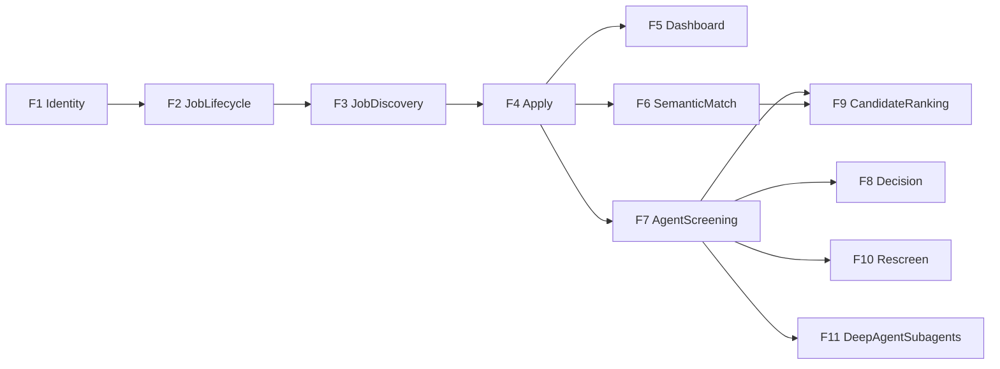

# 04 — פיצ'רים (יחידות פונקציונליות שלמות)

כל פיצ'ר כולל: מסך או API, Command ו/או Query, אירוע אם יש כתיבה, ובדיקה. לא מממשים "מחלקה בודדת" כמשימה.

## F1 Identity — FR-2, FR-3

- שתי דלתות, כמו באתרי גיוס: **מועמדים** (`/auth/login`, `/auth/register`) ו**מגייסים** (`/auth/recruit/login`, `/auth/recruit/register`).
- הרשמת מועמד יוצרת `candidate` בלבד, גם אם נשלח שדה תפקיד. הרשמת מגייס מחייבת בחירה: מגייסת (`hr`) או מנהל גיוס (`hiring_manager`).
- כל דלת עוצרת חשבון מהסוג האחר ומפנה לדלת הנכונה.
- כניסה עם Google בשתי הדלתות, לצד סיסמה (פירוט ב-[08-decisions](08-decisions.md), D17).
- תפריט לפי תפקיד. מגייסים נוחתים בדשבורד, מועמדים ברשימת המשרות.

| פעולה | מועמד | מגייסת | מנהל גיוס |
|---|---|---|---|
| חיפוש והגשת CV | כן | | |
| כתיבת טיוטת משרה | | כן | |
| אישור פתיחה וסגירה | | | כן |
| דירוג, דמיון, דשבורד, דוח | | כן | כן |
| החלטה והערכה חוזרת | | כן | |

## F2 JobLifecycle — FR-4.5

- HR יוצר משרה (Draft) עם כישורי חובה/רצוי, ניסיון, מיקום, תיאור.
- HiringManager מאשר → Open. רק הוא.
- HiringManager סוגר משרה.

## F3 JobDiscovery — FR-4.1, FR-4.2, FR-4.3

- חיפוש משרות פתוחות.
- כרטיס לכל משרה, דפדוף, וספירת המשרות הפתוחות.
- דף פרטי משרה.

## F4 Apply — FR-4.5, NFR-6 (חלק)

- מועמד מגיש מועמדות + קובץ CV (txt/pdf טקסט).
- אירוע ApplicationSubmitted + הטמעה ב-Chroma.

## F5 Dashboard — FR-4.4

- משרות פתוחות.
- מספר נרשמים לכל משרה.
- גרף התפלגות סטטוסי מועמדויות.

## F6 SemanticMatch — FR-4.1, NFR-6

- HR בוחר משרה ומקבל מועמדים דומים סמנטית מ-Chroma.

## F7 AgentScreening — FR-5, NFR-9, NFR-10, NFR-11

- Worker קורא Submitted, מריץ סדרת בדיקות, כותב ApplicationScreeningCompleted.

## F8 Decision — FR-4.5, FR-4.2

- HR רואה דוח + ציר זמן אירועים.
- החלטה Interview / Reject / Offer.
- ה-view רושם רק את אירוע ההחלטה. ה-worker שולח למועמד מייל בעברית דרך Gmail MCP (`send_email`) ורושם `DecisionEmailSent` או `DecisionEmailFailed`. מייל אחד לכל החלטה, עד 3 ניסיונות. ראיון והצעה: "שמחים להמשיך איתך". דחייה: "לא ממשיכים איתך, מכיוון ש...".
- כשמנהל מגייס סוגר משרה נרשם `JobClosureAnnounced` לכל מועמד שעוד לא נדחה, וה-worker שולח מייל שהמשרה נסגרה. מועמד שכבר נדחה לא מקבל את המייל הזה.
- בלי התחברות ל-Gmail המייל נשאר ממתין ושום דבר לא נרשם.
- דף המועמדות מראה ל-HR לכל החלטה: נשלח ל-..., ממתין לשליחה, או נכשל ולמה.

## F9 CandidateRanking: FR-4.3, NFR-6

- דף `/jobs/<id>/ranking`, ל-HR ולמנהל גיוס בלבד.
- Query בלבד (`app/queries/ranking.py`): מועמדים שהוערכו ממוינים לפי ציון הסוכן. מי שעוד לא הוערך מדורג אחריהם לפי דמיון וקטורי חי מ-Chroma.
- לכל מועמד: ציון כולל, כיסוי דרישות, התאמה סמנטית, ראיות רשת, המלצה, כישורים חסרים. בראש הדף: כמה להתקדם / להמתין / לדחות.
- אין אירוע: הפיצ'ר קורא בלבד.

## F10 Rescreen: FR-5, NFR-8

- המגייסת מבקשת הערכה חוזרת עם נימוק, למועמדות `Screened` או `ScreeningFailed`.
- Command `request_rescreen` → אירוע `ApplicationRescreenRequested` → פרויקציה מחזירה ל-`Submitted`, וה-worker מעריך שוב.
- הבקשה מאפסת את מונה הכישלונות (3 ניסיונות חדשים).
- דף המועמדות מציג "היסטוריית הערכות" שנבנית מזרם האירועים: כל ציון קודם, השינוי ביניהם, ומי ביקש ולמה. שום הערכה לא נמחקת.

## F11 DeepAgentSubagents: NFR-11

- הסוכן הראשי מתכנן (`write_todos`) ומאציל דרך הכלי `task` לשני תתי-סוכנים:
  - `cv-analyst`: כלי MCP Studio + RAG.
  - `web-researcher`: Tavily MCP.
- כל קריאה לכלי נרשמת עם שם הסוכן שקרא לה (`delegation`), ומוצגת בדוח ל-HR.
- מודל: `LLM_PROVIDER=auto` = Gemini, ואם אין מפתח או שההרצה נכשלה, Ollama מקומי.
