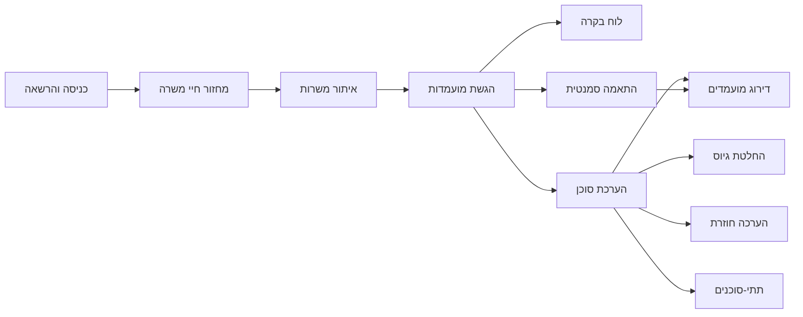

# 04 — אפיון פונקציונלי

יחידות התפקוד של FitScreen. כל יחידה כוללת מסך, כתיבה או קריאה, אירוע כאשר יש שינוי, ובדיקה.

## כניסה והרשאה

שתי דלתות, כמקובל במערכות גיוס.

- מועמדים: `/auth/login`, `/auth/register`. הרשמה יוצרת תפקיד מועמד בלבד, גם אם נשלח שדה תפקיד אחר.
- מגייסים: `/auth/recruit/login`, `/auth/recruit/register`. ההרשמה מחייבת בחירה: מגייסת או מנהל גיוס.
- חשבון שנכנס בדלת שאינה שלו נעצר ומופנה לדלת הנכונה.
- כניסה בסיסמה, ובנוסף כניסה עם Google בשתי הדלתות. בלי `GOOGLE_CLIENT_ID` ו-`GOOGLE_CLIENT_SECRET` הכפתור אינו מוצג והנתיב מחזיר 404.
- אחרי כניסה, מגייסים נוחתים בלוח הבקרה ומועמדים ברשימת המשרות.

| פעולה | מועמד | מגייסת | מנהל גיוס |
|---|---|---|---|
| חיפוש והגשת קורות חיים | כן | | |
| כתיבת טיוטת משרה | | כן | |
| אישור פתיחה וסגירה | | | כן |
| דירוג, התאמה סמנטית, לוח בקרה, דוח | | כן | כן |
| החלטה והערכה חוזרת | | כן | |

## מחזור חיי משרה

- מגייסת יוצרת משרה במצב טיוטה: כישורי חובה, כישורים רצויים, ניסיון, מיקום, תיאור.
- מנהל גיוס מאשר פתיחה. רק הוא. עד האישור המשרה אינה גלויה למועמד.
- ברשימת המשרות ובלוח הבקרה מנהל הגיוס רואה טיוטות הממתינות לאישור, ויכול לאשר פתיחה משם.
- מנהל גיוס סוגר משרה. רק הוא.

## איתור משרות

- חיפוש משרות פתוחות.
- כרטיס לכל משרה, דפדוף, וספירת המשרות הפתוחות.
- דף פרטי משרה.

## הגשת מועמדות

- מועמד מגיש מועמדות עם קובץ קורות חיים: TXT, או PDF שמכיל טקסט.
- נרשם אירוע `ApplicationSubmitted`, וטקסט הקורות חיים מוטמע ב-Chroma.

## לוח בקרה

למגייסת ולמנהל גיוס.

- משרות פתוחות ומספר הנרשמים לכל משרה.
- גרף התפלגות סטטוסי המועמדויות.
- טבלת המשרות הפתוחות מדפדפת. הכרטיסים והגרף מחושבים על כל המשרות הפתוחות, לא על עמוד הטבלה בלבד.

## התאמה סמנטית

מגייסת או מנהל גיוס בוחרים משרה ומקבלים מועמדים שקורות החיים שלהם קרובים סמנטית למשרה, מתוך Chroma.

## הערכת סוכן

תהליך הרקע קורא מועמדויות במצב הוגש, מריץ את בדיקות הסוכן, ורושם `ApplicationScreeningCompleted`. ההערכה אינה רצה בתוך בקשת הדפדפן.

## החלטת גיוס

- המגייסת רואה את הדוח ואת ציר זמן האירועים.
- ההחלטה היא זימון לראיון, דחייה, או הצעת עבודה, עם נימוק.
- ה-view רושם רק את אירוע ההחלטה. תהליך הרקע שולח למועמד מייל בעברית דרך Gmail ורושם `DecisionEmailSent` או `DecisionEmailFailed`. מייל אחד לכל החלטה, עד שלושה ניסיונות.
- זימון והצעה: "שמחים להמשיך איתך". דחייה: "לא ממשיכים איתך", עם הנימוק.
- סגירת משרה רושמת `JobClosureAnnounced` לכל מועמד שטרם נדחה, ותהליך הרקע שולח מייל שהמשרה נסגרה. מועמד שכבר נדחה אינו מקבל מייל זה.
- בלי התחברות ל-Gmail המייל נשאר ממתין ואינו נרשם.
- דף המועמדות מציג למגייסת, לכל החלטה: נשלח אל, ממתין לשליחה, או נכשל והסיבה.

## דירוג מועמדים

- הנתיב `/jobs/<id>/ranking`, למגייסת ולמנהל גיוס בלבד.
- קריאה בלבד (`app/queries/ranking.py`). מועמדים שהוערכו ממוינים לפי ציון הסוכן. מי שטרם הוערך מדורג אחריהם לפי דמיון וקטורי חי מ-Chroma.
- לכל מועמד: ציון כולל, כיסוי דרישות, התאמה סמנטית, ראיות רשת, המלצה, כישורים חסרים. בראש הדף: כמה להתקדם, להמתין, לדחות.
- אין אירוע. היחידה קוראת בלבד.

## הערכה חוזרת

- המגייסת מבקשת הערכה חוזרת עם נימוק, למועמדות בסטטוס `Screened` או `ScreeningFailed`.
- הפקודה `request_rescreen` רושמת `ApplicationRescreenRequested`. הפרויקציה מחזירה את הסטטוס ל-`Submitted`, ותהליך הרקע מעריך מחדש.
- הבקשה מאפסת את מונה הכישלונות: שלושה ניסיונות חדשים.
- דף המועמדות מציג היסטוריית הערכות מזרם האירועים: כל ציון קודם, השינוי, ומי ביקש ולמה. הערכה קודמת אינה נמחקת.

## תתי-סוכנים

הסוכן הראשי מתכנן ומאציל לשני תתי-סוכנים:

- `cv-analyst`: כלי MCP Studio ו-RAG.
- `web-researcher`: Tavily.

כל קריאה לכלי נרשמת עם שם תת-הסוכן שקרא לה, ומוצגת בדוח למגייסת. `LLM_PROVIDER=auto`: Gemini, ואם אין מפתח או שההרצה נכשלה, Ollama מקומי.
