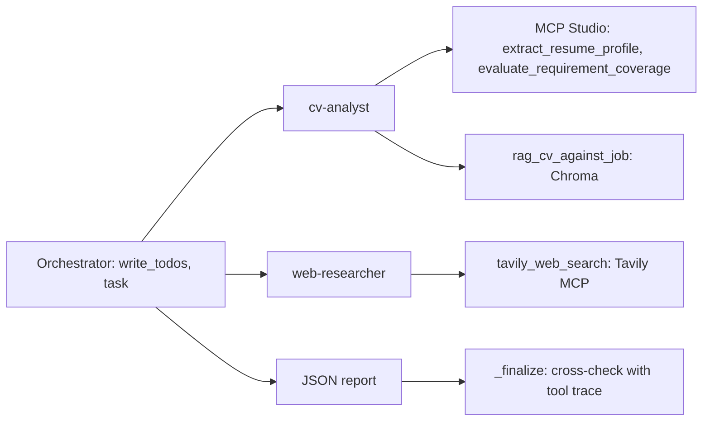

# 05 — איך הסוכן נותן ציון

הסוכן רץ בתהליך נפרד מהאתר. יש לו מנהל ושני עוזרים: אחד קורא את קורות החיים, והשני מחפש באינטרנט. הציון מגיע מהכלים. המודל לא ממציא מספר משלו.

## במה הוא משתמש

- **LangChain Deep Agents**: `deepagents.create_deep_agent(model, tools=[], system_prompt, subagents=[...])` ב-`agent/deep_agent.py`.
- הכלים `extract_resume_profile` ו-`evaluate_requirement_coverage` נקראים **רק** דרך MCP stdio (`python -m mcp_studio`).
- חיפוש רשת: שרת **Tavily MCP** (`tavily-mcp`), לא REST ישיר. שם הכלי מזוהה דינמית (`tavily_search` / `tavily-search`).
- RAG: Chroma עם all-MiniLM-L6-v2. קורות חיים נשמרים כמסמך מלא (לדירוג) וכקטעים (לציטוטים).

## מבנה: מתזמר ושני תתי-סוכנים



- **Orchestrator**: אין לו כלי סינון משלו. הוא כותב תוכנית, מאציל ב-`task`, ומחבר את התשובות לדוח JSON.
- **cv-analyst**: שלושת כלי הניתוח. הכלים לא מקבלים את טקסט ה-CV מהמודל. הם קוראים אותו מהמועמדות עצמה, כך שהמודל לא יכול לשנות את מה שנבדק.
- **web-researcher**: חיפושי Tavily לפי השם המלא במרכאות, אחר כך שם + מעסיק, אחר כך שם + כותרת המשרה. אין חיפוש כתובת GitHub, אין חיפוש LinkedIn, ואין חיפוש טכנולוגיה לבדה. דף נשמר רק אם מופיעים בו השם, האימייל או כתובת הפרופיל. אם יש GitHub בקורות החיים, `_finalize` קורא מאגרים ושפות ומשווה לכישורי המשרה.
- כל קריאה לכלי נרשמת ב-trace עם שם הסוכן שקרא לה, ונשמרת בדוח כ-`delegation`.

## בחירת מודל

| `LLM_PROVIDER` | התנהגות |
|---|---|
| `auto` (ברירת מחדל) | Gemini. אם אין מפתח או שההרצה נכשלה: Ollama מקומי, אם הוא עונה והמודל הורד |
| `gemini` | Gemini בלבד (`GEMINI_API_KEY`, `GEMINI_MODEL`) |
| `ollama` | Ollama בלבד (`OLLAMA_BASE_URL`, `OLLAMA_MODEL`, `OLLAMA_NUM_CTX`) |

Ollama מותקן על Windows (לא בתוך Docker), וה-worker מגיע אליו דרך `host.docker.internal`. `OLLAMA_NUM_CTX=16384` נדרש כי ההנחיות והכלים של deepagents לא נכנסים בהקשר ברירת המחדל של Ollama. על מעבד בלבד, בלי כרטיס מסך, הערכה ב-Ollama לוקחת יותר מ-10 דקות, ולכן Gemini ראשי.

## למה process נפרד

המפרט דורש process עצמאי. הערכה כוללת רשת, RAG ו-LLM ולוקחת עד כמה דקות. בתוך POST של הדפדפן המשתמש ייתקע, והפרדת CQRS תישבר. ב-Docker הסוכן הוא שירות `worker` נפרד מ-`web`.

## תהליך

`python -m agent.worker` רץ בלולאה (`WORKER_POLL_SECONDS`, ברירת מחדל 20) וקורא ישירות מטבלאות הקריאה. בכל סבב הוא שולח קודם מיילי החלטה שממתינים (Gmail MCP, `agent/notifier.py`, פירוט ב-[02-architecture](02-architecture.md)), ואז מעריך מועמדויות. מייל לא עובר דרך ה-LLM: התבנית קבועה.

1. בדיקה מקדימה: אם אין אף מודל זמין, שגיאה בלוג ואף מועמדות לא נוגעת. אין ציון בלי סוכן.
2. לכל מועמדות `Submitted`: `ApplicationScreeningStarted`.
3. הטמעת ה-CV ב-Chroma (idempotent: מבטיח RAG גם אם ההטמעה בזמן ההגשה נכשלה).
4. המתזמר מתכנן ומאציל ל-cv-analyst ול-web-researcher.
5. המתזמר מחזיר JSON. המערכת מצליבה אותו מול ה-trace (`_finalize`):
   - ציוני הרכיבים נלקחים מהכלים, לא ממה שהמודל טען.
   - כלי חובה שאף סוכן לא הפעיל מופעל ונרשם ב-`tools_skipped_by_agent`.
   - JSON לא תקין מהמודל: הציונים מחושבים מהכלים ו-`agent_report_valid=false`.
   - כישלון Tavily נרשם בפערים, והמשקל מחולק מחדש בין הרכיבים הקיימים.
6. `ApplicationScreeningCompleted` עם הדוח המלא.
7. כישלון: `ApplicationScreeningFailed`. אחרי 3 כישלונות הסטטוס `ScreeningFailed` ו-HR רואה את השגיאה.
8. הערכה חוזרת: האירוע `ApplicationRescreenRequested` מחזיר את המועמדות לתור ומאפס את מונה הכישלונות.

## פורמט הדוח

```json
{
  "overall_score": 0,
  "skill_coverage": 0,
  "semantic_fit": 0,
  "web_score": 0,
  "recommendation": "advance|hold|reject",
  "agent_recommendation": "advance|hold|reject",
  "agent_report_valid": true,
  "summary": "",
  "strengths": [],
  "gaps": [],
  "web_evidence": [{"title": "", "url": "", "finding": ""}],
  "cv_excerpts": [],
  "profile": {},
  "tools_used": [],
  "tools_skipped_by_agent": [],
  "delegation": [{"tool": "extract_resume_profile", "by": "cv-analyst"}],
  "runtime": "deepagents:gemini:gemini-2.5-flash"
}
```

## ציון והמלצה

`overall = 0.45*skill_coverage + 0.35*semantic_fit + 0.20*web_score`  
`advance` ≥ 70 · `hold` 45–69 · `reject` < 45

`skill_coverage` ו-`semantic_fit` נלקחים מהכלים. `web_score` הוא ממוצע של שני חלקים כששניהם קיימים: חיפוש השם ב-Tavily (55 אם יש דף עם השם, ועוד אם גם המעסיק מופיע באותו דף), וניתוח תיק GitHub (שפות ומאגרים מול כישורי החובה). דף Tavily שלא מזכיר את המועמד לא נכנס לדוח. קישור GitHub מהקורות החיים עצמו אינו ראיה מהחיפוש. אם החיפוש נכשל וגם אין תיק GitHub, משקל הרשת מתחלק מחדש בין כיסוי הדרישות להתאמה הסמנטית. המספר שהמודל כתב לא נכנס לציון. קישור שמוסתר מאחורי המילה GitHub או LinkedIn ב-PDF נקרא מיעד הלחיצה ומצורף לטקסט. בדוח שמור מוצג תיק GitHub חי בלי לשנות את הציון שנשמר.

הסיכום ל-HR בעברית. אם המודל לא כתב סיכום, המערכת כותבת אחד מתוצאות הכלים. בדוח נשמר גם `github_status`: `verified`, `not_found`, `not_provided` או `unchecked`.

`agent_state` בדוח הוא מצב הסוכן כפי שמצגת 7 מגדירה אותו: `plan` (ארבעה צעדים), `current_step`, `tool_calls`, `citations` ו-`confidence` (הציון הכולל מהכלים). הצעדים מסומנים לפי כלים שרצו בפועל, לא לפי טקסט שהמודל כתב. כל כישור חובה ב-`skill_evidence` כולל את המשפט מקורות החיים שבו נמצא, או ריק אם לא נמצא. דוח שנשמר לפני השדה הזה מוצג באותו מבנה בזמן הקריאה, בלי אירוע חדש.

## מצב בדיקות

`FITSCREEN_AGENT_MODE=pipeline` מריץ את אותם כלים בלי LLM, לסוויטת הבדיקות בלבד. בדיקה נפרדת מריצה את `create_deep_agent` עם מודל מתוסרט שעובר orchestrator → cv-analyst → web-researcher, ומוודאת שכל כלי נקרא על ידי תת-הסוכן הנכון ושהדוח הוצלב.

## מכסות Gemini

לכל מודל Gemini יש מכסה יומית חינמית נפרדת (`gemini-2.5-flash`: 20 בקשות ביום). הערכה אחת צורכת כ-12 בקשות. לכן `GEMINI_MODEL` הוא רשימה שעוברים עליה לפי הסדר, עם `max_retries=1`, כך שמכסה שנגמרה (429) או עומס (503) עוברים מיד למודל הבא. רק אחרי כל מודלי Gemini מגיעים ל-Ollama.

## הרצות אמיתיות שנבדקו (Docker, Somee, Tavily)

קורות חיים `samples/cv_python.txt` מול משרת Python Backend, אותה מועמדות:

| הרצה | מנוע | זמן | ציון | הערות |
|---|---|---|---|---|
| 1 | `ollama:qwen2.5:3b` | כ-12 דקות | 81 advance | Gemini החזיר 429 (מכסה), המעבר ל-Ollama קרה לבד |
| 2 (הערכה חוזרת) | `gemini:gemini-2.5-flash-lite` | כדקה | 83 advance | מודל 1 נכשל ברשת, מודל 2 החזיר 503, מודל 3 הצליח |
| 3 (הערכה חוזרת) | `gemini:gemini-3.1-flash-lite` | כ-3 דקות | 83 advance | 3 מקורות Tavily עם קישורים, כולל אימות המעסיק NovaLabs |

בכל ההרצות: אף כלי חובה לא דולג, cv-analyst הפעיל את 3 הכלים, ו-web-researcher את Tavily. "היסטוריית הערכות" מציגה את שלוש ההרצות ואת שתי בקשות ההערכה החוזרת.
